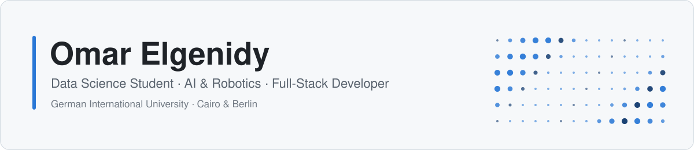
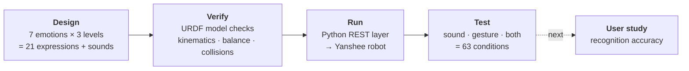
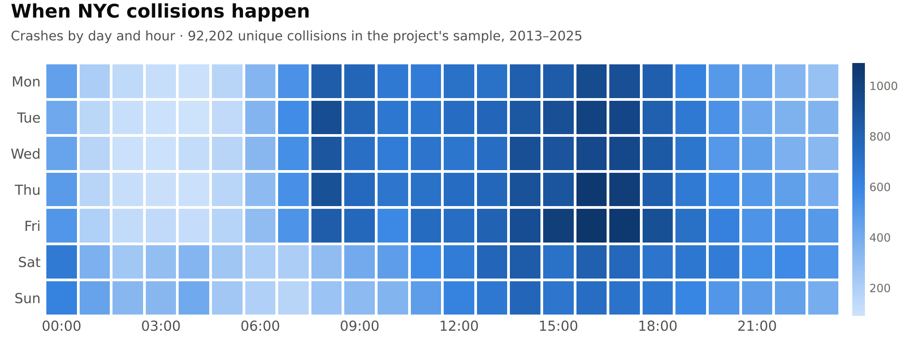
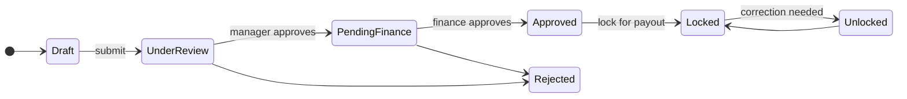

<picture>
  <source media="(prefers-color-scheme: dark)" srcset="assets/banner-dark.svg">
  
</picture>

  
  
  

## About me

I'm a final-year **Computer Science student majoring in Data Science** at the German International University (GIU) in Cairo, and I spent my Spring 2026 semester at **GIU Berlin**.

I like projects where data, software and the physical world meet. Right now that means teaching a humanoid robot to show emotions with its voice and body. Before that, I built data pipelines over millions of records, payroll and booking backends, and relational databases with dozens of tables.

- 🤖 **Currently:** my bachelor thesis on emotional expression in humanoid robots (due January 2027)
- 📊 **Interested in:** machine learning, data engineering, human–robot interaction, backend systems
- 🎓 **Graduating:** July 2027

---

## 🤖 Current focus: Bachelor thesis

### Voice Meets Body: Evaluating Coherent Multimodal Emotional Expression in Humanoid Robots

*Supervised by Assoc. Prof. Nada Sharaf · GIU*

Can people recognise a robot's emotion better when its voice and body move together? I built everything needed to test that question on a real **UBTECH Yanshee** humanoid robot, and the user study is next.

| <h3>63</h3>study conditions | <h3>7</h3>emotions | <h3>21</h3>whole-body expressions | <h3>0</h3>issues in safety checks |
|:---:|:---:|:---:|:---:|

- **Expressions:** each emotion has 3 intensity levels, each based on a recognisable human reaction, with arm, head and leg movement plus eye and chest LED colours. Designs draw on body-language research and animation principles.
- **Safety first:** every pose is checked on UBTECH's own robot model with forward kinematics, a leg solver that keeps both feet flat, a balance check and collision checks. The control code also enforces joint, speed and battery limits and returns to neutral on any error.
- **Tooling:** a dependency-free Python control layer, a mock robot server for testing, and a one-click menu tool that finds every robot on the network.
- **Simulation:** expressions were first prototyped on Unitree G1, R1 and Go2 robots in Webots.

`Python` `REST APIs` `Webots` `URDF` `Forward Kinematics` `Human–Robot Interaction` `LaTeX`

---

## 🚀 Featured projects

### 📊 NYC Motor Vehicle Collisions Analytics

A team data-engineering project that turns NYC Open Data into an interactive dashboard.

- Merged **8M+ crash and person records** into a clean **4.8M-row dataset** with a 5-person team; I owned the post-merge cleaning.
- Co-built **7 interactive Plotly charts** (line, bar, heatmap, pie, map) driven by 6 filters, a year slider and text search.
- Deployed the dashboard publicly on Render with Gunicorn, serving a 95K-row sample.

<picture>
  <source media="(prefers-color-scheme: dark)" srcset="assets/nyc-heatmap-dark.png">
  
</picture>

Made from the project's own sample data: crashes peak on weekday afternoons and drop sharply overnight.

### 💼 HR System: Payroll Processing & Execution

The subsystem that takes a company's monthly payroll from draft to payout, with approvals at every step.

- Wrote **10 DTOs with 270 validation rules** so bad payroll input (runs, payslips, bonuses, termination benefits) is rejected at the API.
- Built an exceptions page that flags employees with **missing bank details** before payout, so staff can fix them first.

### 🎟️ Online Event Ticketing System

A full-stack MERN platform for browsing, booking and managing events.

- Serves **3 roles** (users, organizers, admins) through **24 REST endpoints** and **27 React components**.
- Protects every route with JWT authentication, bcrypt password hashing and role-based access control.
- Prevents overbooking by checking availability and updating ticket counts on every booking and cancellation.

### 🗄️ Gamified Educational Platform Database

- Designed an EERD and a **44-table** relational schema with **52 foreign keys** for learners, courses, quests, badges and leaderboards.
- Wrote **57 T-SQL stored procedures** that power **14 ASP.NET Core MVC controllers**.

### 🍽️ Restaurant Reservation & Management System

- A **52-endpoint** Express/MongoDB API, layered with services over the Repository and Factory patterns.
- Verified every core user story with **39 Jest tests** (25 unit, 6 integration, 8 end-to-end), written test-first.

---

## 🛠️ Tech stack

**Languages**

**Data, AI & robotics**

 &nbsp; Pandas · NumPy · Matplotlib · Plotly · Dash · Webots · URDF

**Backend & full-stack**

**Databases**

 &nbsp; SQL Server

**Tools & cloud**

 &nbsp; Power BI · Render

---

## 📫 Let's connect

I'm open to internships and graduate roles in **data science, machine learning, robotics and backend engineering**.

  
  

